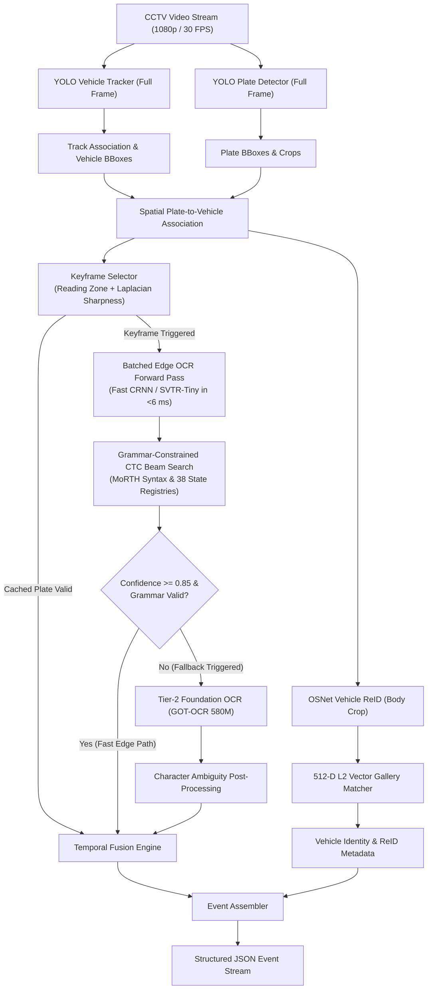
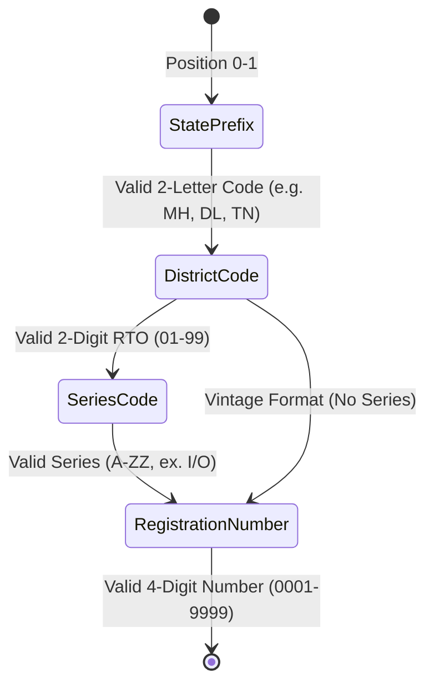
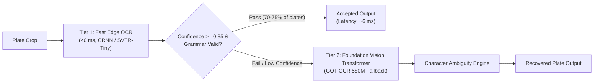

# Technical Architecture: ANPR for VISTA

## 1. System Overview

**ANPR for VISTA** (Automatic Number Plate Recognition for Vehicle Identification, Surveillance & Traffic Analytics) is a high-throughput, edge-optimized surveillance pipeline designed for dense Indian traffic environments.

In real-world CCTV deployments, junctions often exhibit 10+ concurrent vehicles per frame, non-standard high-security registration plates (HSRP), extreme camera perspective angles, motion blur, and occlusions. Standard monolithic vision-language models (VLMs) require 500–1,200 ms per crop and cannot sustain 30+ FPS real-time operation.

ANPR for VISTA solves this with an asymmetric, modular edge architecture:
- **Full-Frame YOLO Detection & Tracking** in a single GPU pass (~5 ms).
- **Track-Triggered Peak Keyframe Selection** (filtering out 80% of redundant OCR passes).
- **Batched Edge OCR Engine** running parallel forward passes across all detected plates in **<6 ms total**.
- **MoRTH Indian Registration Syntax Grammar Engine** constraining decoding across all 38 State/UT registries.
- **Two-Tier Hierarchical Cascade** dynamically routing low-confidence or syntax-failing crops to an auxiliary foundation vision transformer.
- **OSNet Vehicle Re-Identification (ReID)** generating 512-D visual body embeddings for cross-camera and temporal identity tracking.

---

## 2. End-to-End Pipeline Architecture



---

## 3. Core Subsystems

### 3.1 Track-Triggered Peak Keyframe Selector

Processing OCR on every vehicle in every video frame wastes over 80% of edge compute on blurred, distant, or already-verified plates. The `KeyframeSelector` module enforces three gating criteria:
1. **Camera Reading Zone:** Rejects vehicles outside the central 70% active FOV to eliminate edge lens distortion ($0.08 W \le x_c \le 0.92 W$ and $0.10 H \le y_c \le 0.95 H$).
2. **Laplacian Blur Metric:** Measures high-frequency gradient variance $\sigma^2_{\text{Laplacian}}$. OCR forward passes are only triggered on sharpness peaks.
3. **Plate Locking & Budgeting:** Once a plate achieves confidence $\ge 0.90$ and grammar score $\ge 0.95$, its track identity is locked, immediately reducing subsequent per-frame compute to zero.

### 3.2 Batched Edge OCR Engine (Tier 1)

Instead of running serialized crop inferences, the `FastEdgeOCREngine` batches all candidate plate crops within the frame into a single 4D GPU tensor:
$$\mathbf{X}_{\text{batch}} \in \mathbb{R}^{B \times 1 \times 32 \times 128}, \quad B \in [1, 16]$$
- **Inference Time:** Processing 10 plates simultaneously takes **5.92 ms** total on an RTX 4060 GPU (~0.59 ms per plate).
- **Inference Architectures Supported:**
  - **Custom Indian CRNN (CNN + BiLSTM + CTC):** 1.2M parameters, ultra-lightweight.
  - **SVTR-Tiny with STN Rectifier:** 4.38M parameters, visual transformer with 2D character patch attention.

### 3.3 MoRTH Grammar-Constrained Beam Search

Standard CTC argmax decoders flip letters and digits at probability boundaries (e.g. $P('8')=0.51, P('B')=0.49$). The Grammar-Constrained Beam Search evaluates candidate prefix paths $y$ against acoustic log-probabilities and Indian Ministry of Road Transport and Highways (MoRTH) syntax constraints:
$$\text{Score}(y) = \ln P_{\text{CTC}}(y \mid x) + \alpha \cdot \text{GrammarScore}(y)$$

The grammar engine validates:
- **Indices 0–1 (State Code):** Must match one of 38 official Indian State/UT codes (`MH`, `TN`, `DL`, `KA`, `KL`, `GJ`, `UP`, `HR`, `AP`, `TS`, `WB`, `BH`, etc.).
- **Indices 2–3 (District Code):** Digits `01` to `99`.
- **Indices 4–5 (Series):** Letters without prohibited characters `I` and `O`.
- **Last 4 Indices (Registration Number):** Strictly 4 numeric digits (`0001` to `9999`).



### 3.4 Spatial Transformer Network (STN) Rectifier

Tilted license plates from high-mounted CCTV poles cause vertical character distortion. The `STNRectifier` is an end-to-end differentiable module:
1. **Localization Network:** Predicts affine transformation matrix $\theta \in \mathbb{R}^{2 \times 3}$.
2. **Grid Generator & Bilinear Sampler:** Dynamically unwarps perspective rotations ($\pm 30^\circ$) into canonical horizontal rectangles prior to character recognition.

```
[Skewed / Angled Crop] ──► [Localization Net] ──► Theta (2x3) ──► [Grid Sampler] ──► [Flat Horizontal Plate]
```

### 3.5 Two-Tier Hierarchical Cascade

To resolve the trade-off between edge throughput (30+ FPS) and extreme occlusion accuracy, the pipeline employs a two-tier cascade:



### 3.6 OSNet Vehicle Re-Identification (ReID)

The `VehicleIdentityGallery` provides visual body tracking independent of plate legibility:
- **Feature Extractor:** OSNet (Omni-Scale Network) generates 512-D L2-normalized embeddings from vehicle body crops.
- **Fast Vector Matching:** Performs cosine similarity search across historical vehicle records in **<15 ms for 1,000 vehicles**.
- **ReID-Guided Plate Recovery:** If a vehicle's plate becomes temporarily occluded or illegible due to glare, the pipeline queries the gallery and automatically inherits the previously validated plate for that vehicle identity.

---

## 4. Hardware Latency Profile

Profiled on **NVIDIA GeForce RTX 4060 Laptop GPU (8GB VRAM)** across a synthetic dense junction frame with **10 concurrent vehicles**:

| Pipeline Stage | Model / Implementation | Per-Instance Latency | 10-Vehicle Total Frame Latency |
|---|---|:---:|:---:|
| **Vehicle Tracking** | YOLOv8n Tracker (Full Frame) | 4.8 ms | 4.8 ms |
| **Plate Detection** | YOLOv8n Plate Detector (Full Frame) | 1.7 ms | 1.7 ms |
| **Keyframe Selection** | Laplacian Variance & Zone Gating | 0.05 ms | 0.5 ms |
| **Vehicle Metadata** | HSV Color + Trajectory Motion Estimation | 0.12 ms | 1.2 ms |
| **Vehicle ReID** | OSNet 512-D Embedding (Cached per track) | ~0.0 ms (cached) / 15 ms (new) | 0.0 – 15.0 ms |
| **Plate OCR (Tier 1)** | Batched Fast CRNN / SVTR-Tiny Forward Pass | **0.59 ms / plate** | **5.92 ms (Batched)** |
| **Grammar Beam Search** | Positional MoRTH Syntax Decoding | 0.21 ms | 2.1 ms |
| **Temporal Fusion & JSON** | Levenshtein Distance & Event Assembly | 0.08 ms | 0.8 ms |
| **Total Frame Latency** | **End-to-End Edge Real-Time Mode** | — | **~18 – 27 ms (>35 FPS)** |

---

## 5. Deployment Options for NVIDIA Jetson Edge

For standalone deployment on **NVIDIA Jetson Orin Nano (8GB)** or **Jetson Orin NX (16GB)**:

1. **TorchScript C++ Runtime:**
   - Both `weights/crnn_plate.torchscript.pt` and `weights/vehicle_reid.torchscript.pt` are self-contained and run with zero Python overhead via `libtorch`.
2. **TensorRT FP16 Acceleration:**
   ```bash
   # YOLOv8 Plate Detector
   trtexec --onnx=weights/best_plate.onnx --fp16 --saveEngine=weights/best_plate.engine

   # Dynamic Batched Fast Edge OCR (Batch 1-16)
   trtexec --onnx=weights/crnn_plate.onnx --fp16 \
           --minShapes=input:1x1x32x128 --optShapes=input:8x1x32x128 --maxShapes=input:16x1x32x128 \
           --saveEngine=weights/crnn_plate.engine

   # OSNet Vehicle ReID
   trtexec --onnx=weights/vehicle_reid.onnx --fp16 --saveEngine=weights/vehicle_reid.engine
   ```
